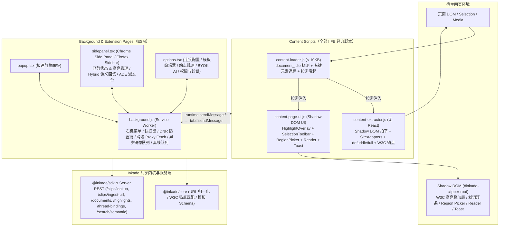
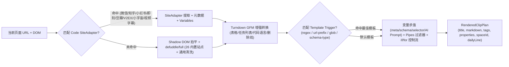
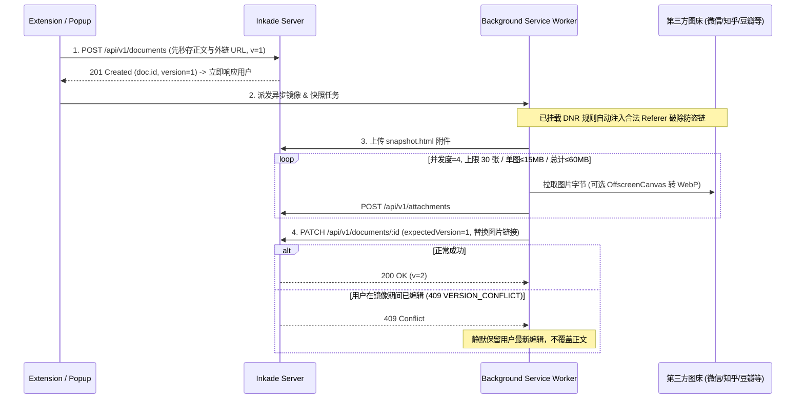

# Inkade 旗舰级浏览器剪藏插件架构设计文档（`@inkade/clipper`）

> **设计准则**：基于 MIT 协议的 `defuddle` 清洗引擎与声明式模板生态设计，结合 Inkade 统一知识库与外部 Agent 原生联动能力，构建 **100% 宽松开源许可（MIT / Apache-2.0 / BSD / ISC）**、全栈 TypeScript 单一真相源驱动的跨浏览器 MV3 扩展。

---

## 一、开源许可边界与技术选型

### 1.1 为什么基于 MIT 积木独立构建 `@inkade/clipper`？

| 评估维度 | 上游通用 MV3 剪藏项目 | Inkade 最终决策 |
| :--- | :--- | :--- |
| **开源协议** | 严守仓库第一铁律：全依赖仅允许 MIT/Apache-2.0/BSD/ISC | **禁止引入 AGPL / GPL / BSL 或未批准 MPL 传递依赖**，保持洁净 MIT 架构 |
| **工程栈** | Webpack / `webextension-polyfill`（MPL-2.0）等传统栈 | `@inkade/clipper` 采用 **Bun.build + React 19 + `@inkade/core` + `@inkade/sdk` + `@inkade/i18n`**，手写轻量 `webext.ts` 与打包校验脚本，0 MPL/AGPL 传递依赖 |
| **核心提取** | 复用 MIT **`defuddle/full`**（内置 26 站点 Extractor、MathML→LaTeX、Shadow DOM 拍平） | **复用 MIT `defuddle/full`** + 增强 Shadow DOM 克隆拍平 + **自研 8 个中文/视频站点 `SiteAdapter`** |
| **写入 Sink** | 本地 URI / 剪贴板写入 | 原生直连 `@inkade/sdk`（REST + Scoped Token + 乐观锁 + SSE/RAG/Daily/ADE） |
| **Agent 联动** | 静态导入为主 | **Side Panel 语义回忆（Hybrid RAG）+ 一键入今日 Daily 大纲 + 派发 `AdeThreadBinding`** |

---

## 二、整体分层架构（5 入口分离 + 零污染隔离）



### 2.1 运行时打包铁律

1. **Content Scripts（`content-loader.js`、`content-extractor.js`、`content-page-ui.js`）必须打包为 `format: "iife"`**：
   - MV3 声明式 `content_scripts` 与 `chrome.scripting.executeScript` 以 classic script 语义加载文件，禁止顶层 `export`/`import` 语句。
   - `scripts/verify-bundles.ts` 在每次构建后使用语法校验与特征检测强制验证所有 content script 产物的 classic script 合法性。
2. **UI 与抓取彻底解耦**：
   - `content-loader.js` 不包含 React、Defuddle、Turndown，体积压制在 `< 10KB`，未命中的网页零额外内存开销。
   - `content-extractor.js` 不加载 React，专注 DOM 克隆、站点适配、Defuddle 解析与 W3C `TextQuoteSelector` 上下文提取。
   - `content-page-ui.js` 全部样式和 DOM 封装在 `#inkade-clipper-root` 的 ShadowRoot 中，绝不污染宿主页面样式或破坏 React/Vue 水合。
3. **Chrome/Edge 与 Firefox 分端生成 Manifest**：
   - `dist/chrome/`（同步至 `dist/`）：`background.service_worker` + `side_panel` + `permissions: ["activeTab", "storage", "contextMenus", "scripting", "sidePanel", "declarativeNetRequestWithHostAccess"]`（无 Firefox 专属字段，`commands` 中带 `suggested_key` 严格 ≤ 4 个）。
   - `dist/firefox/`：`background.scripts` + `sidebar_action` + `browser_specific_settings.gecko`（无 Chrome 专属 `sidePanel` 权限）。

---

## 三、核心子系统设计

### 3.1 `@inkade/core` 单一真相源增强（`packages/core/src/clipper.ts`）

- **`normalizeClipUrl(rawUrl, options?)`**：统一小写协议与主机名、剥离 `#hash`、规范化尾斜杠、自动剔除追踪参数（`utm_*`、`fbclid`、`gclid`、`spm`、`ref_src`、`igsh`、`igshid`、`vd_source`、`share_source` 等）并对剩余 Query 按键排序。后端 `GET /api/v1/clips/lookup` 与前端查重完全共用此算法。
- **`matchHighlightAnchor(text, anchor)` & `buildHighlightContextFromText`**：将 W3C 三重上下文模糊匹配算法（精确匹配 + 上下文相似度消歧 → 空白折叠大小写不敏感匹配 → 长段首部分锚点容错回退）从 UI 包下沉至 `@inkade/core`，让 Web `ArticleReader` 与浏览器插件原生网页叠加层共用同一套定位引擎。
- **`ClipperTemplate` Zod Schema 与云端同步标记**：通过 `CLIPPER_TEMPLATE_MARKER` 将扩展自定义模板序列化存储在现有 `/api/v1/templates`（`kind: "clip"`）中，无需新增数据库表即可实现跨设备模板同步。

### 3.2 精准查重 API（`GET /api/v1/clips/lookup`）

- 解决旧版 `documents.list({ kind: "clip", limit: 50 })` 超过 50 篇即失效的缺陷。
- 服务端严格经过 `principalMiddleware` 与 `evaluateScopeAccess(principal.scope, "read", ...)` 过滤，受限 Token 绝不会探测到无权 Space 内的剪藏。
- 一次返回 `{ found, normalizedUrl, document, highlights, threadBindings }`，同时驱动 **Loader 高亮回显决策**、**Popup 已剪提示** 与 **Side Panel 状态面板**。

### 3.3 双层扩展机制：Code `SiteAdapter` + 声明式模板引擎



- **代码级 `SiteAdapter`（8 个高频中文/视频专精 + `defuddle/full` 26 站点）**：
  - 支持 **Feed 流右键精准捕获**：`content-loader` 在捕获阶段记录右键点击位置元素，知乎/小红书/即刻/豆瓣等 Feed 流中右键任意单条即可直接锁定对应卡片，不混入无关条目或评论。
  - 统一输出标准 `ExtractedArticle`（含 `variables`、`imageUrls`、`htmlSnapshot`）。
- **声明式模板与过滤器系统**：
  - 触发器支持：`url-prefix`、`glob`、`regex`、`schema-type`（Schema.org `@type`），按优先级自动推荐和切换。
  - 内置 **24 个纯函数管道过滤器**：字符串排版（`trim`、`lower`、`upper`、`capitalize`、`title`、`replace`、`slice`、`truncate`、`strip_tags`、`markdown`、`blockquote`、`callout`、`wikilink`、`slug`、`encode_uri`）、集合数据（`split`、`join`、`first`、`last`、`length`、`unique`、`map`、`default`、`json`）、日期格式化（`date`）。
  - 逻辑指令支持：`......` 与 `...`。
  - 原生直通 Inkade 数据模型：直接输出 `targetSpaceId`、`tags`、`properties`（带 `text/number/boolean/list/date` 类型校验写入 `document.properties`）、以及 `appendToDaily` 自动追加今日 Daily 节点。

### 3.4 高可靠异步图片镜像 & DNR 防盗链



### 3.5 Agent 深度联动与离线可靠能力

1. **Chrome Side Panel / Firefox Sidebar 伴随面板**：
   - 自动跟随当前标签页刷新状态；
   - **Capture & Highlights**：已剪藏详情、模板切换、区域框选/阅读器入口、页内高亮列表（点击跳到原文位置 + 原地编辑/换色/删评）；
   - **Related Knowledge**：自动请求 `client.searchSemantic`（Hybrid RRF，自动兼容回退 BM25），浮现个人知识库相关研究与历史剪藏，一键复制 `[[双链]]`；
   - **Dispatch to ADE**：一键创建带完整 `selectionAnchor` 和原文链接的 `AdeThreadBinding`（`status: "queued"`），可选同时写入今日 Daily 大纲，供任意已连接 Agent（如 Claude Code / Codex / Cursor 等）认领执行。
2. **可选 BYOK AI Interpreter**：
   - 原生 `fetch` 适配 OpenAI Compatible / Anthropic / Gemini（0 外部重型 SDK），支持模板 `{{"prompt"}}` 变量自动求值及一键生成摘要与标签；`apiKey` 严格隔离在 `storage.local`（不进 `storage.sync`）。
3. **离线队列与自动恢复**：
   - 断网或服务端暂时不可用时，所有剪藏、高亮、Daily 追加与 ADE 派发操作自动持久化入 `storage.local` 离线队列并更新 Badge 待同步计数，恢复后 FIFO 自动补偿提交。

---

## 四、目录结构规划

```text
apps/clipper/
├── manifest.json                     # 兼容保留 / 构建校验源
├── popup.html / sidepanel.html / options.html
├── assets/icons/                     # 构建期生成的 16/32/48/128 PNG 图标
├── scripts/
│   ├── generate-icons.ts             # 零依赖 PNG 品牌图标生成器
│   ├── manifests.ts                  # Chrome / Firefox 分端 Manifest 生成器
│   ├── build.ts                      # IIFE + ESM 分流混淆压缩构建器
│   └── verify-bundles.ts             # 产物、Classic Script 语法、Manifest 与体积门禁
└── src/
    ├── shared/
    │   ├── webext.ts                 # 跨浏览器 Promise/Callback WebExtension API 桥接
    │   └── storage.ts                # 设置 / 模板 / 离线队列 / AI 配置存储管理
    ├── core/
    │   ├── markdown-converter.ts     # Turndown + GFM (表格/任务/删除线/语言块)
    │   ├── shadow-dom.ts             # 无侵入开放 Shadow DOM 克隆拍平
    │   ├── extractor.ts              # defuddle/full + SiteAdapter + W3C 选区锚点 + 区域提取
    │   ├── dnr-rules.ts              # declarativeNetRequest 图床防盗链 Referer 规则
    │   ├── image-mirror.ts           # 并发图片镜像 + WebP 压缩 + 409 乐观锁回写
    │   ├── sync.ts                   # 查重 / Clip / Highlight / Daily / ADE Dispatch
    │   ├── interpreter.ts            # BYOK AI Interpreter (OpenAI / Anthropic / Gemini)
    │   ├── offline-queue.ts          # 持久化离线同步队列与 FIFO 补偿器
    │   ├── adapters/                 # 8 个中文/视频专精 SiteAdapter + 注册表
    │   └── templates/                # 24 过滤器 + 模板编译器 + 6 套预设 + 云同步
    ├── background/
    │   └── index.ts                  # Service Worker：菜单、快捷键、镜像后台任务、CORS Proxy、DNR
    ├── content/
    │   ├── loader.ts                 # <10KB 懒加载入口 + Feed 右键目标跟踪
    │   ├── extractor-entry.ts        # 按需注入抓取 IIFE 入口
    │   ├── highlight-renderer.ts     # 宿主文本索引 + Range ClientRects 算子
    │   ├── page-ui-styles.ts         # Shadow DOM 隔离样式表
    │   ├── SelectionToolbar.tsx      # 划词悬浮工具条
    │   ├── HighlightOverlay.tsx      # 双向 W3C 高亮叠加层 & Popover
    │   ├── RegionPicker.tsx          # 键盘可调网页区域框选器
    │   ├── ReaderOverlay.tsx         # 内置安全 Reader View
    │   ├── ToastHost.tsx             # 右下角通知栈
    │   └── page-ui-entry.tsx         # Shadow DOM 容器挂载与消息总线
    └── ui/
        ├── styles.css                # Tailwind v4 + @inkade/ui/styles.css 主题入口
        ├── theme.ts                  # 系统深浅色偏好同步 (.dark Token)
        ├── popup.tsx                 # 极速剪藏主弹窗 (@inkade/ui/primitives)
        ├── sidepanel.tsx             # 3 标签页伴随工作台 (@inkade/ui/primitives)
        ├── TemplateManager.tsx       # 可视化模板管理器 & 云同步面板 (@inkade/ui/primitives)
        └── options.tsx               # 多分区完整设置页 (@inkade/ui/primitives)
```
